<div align="center">


# MX Music · 墨玄音乐

**把自己家的 NAS 音乐库和手机本地音乐，装进一个播放器里听。**

> ### [⬇ 下载最新版 APK](https://github.com/gzwzk888/mx-music/releases/latest)
> 当前版本 **b136** · Android 8.0+ · arm64-v8a · 22.4 MB · [查看更新记录](CHANGELOG.md)


个人自用的 Android 音乐播放器，基于开源项目 [LX Music Mobile](https://github.com/lyswhut/lx-music-mobile) 修改。
针对平板与「本地 + NAS」双音源场景做了较多改动，不是官方版本，也不上架任何应用商店。

[](LICENSE)
[](#安装)
[](package.json)

</div>

> **English (short)**: MX Music is a personal Android music player forked from LX Music Mobile.
> It adds DLNA/NAS browsing with a persistent library index, local MediaStore scanning, a
> "recent / random 100" grid playlist, lyric offset tuning and desktop lyrics.
> Not an official LX Music release. Apache-2.0, for personal and educational use.

---

## 截图

**平板（横屏）**

| 播放页（左封面 · 右歌词） | 歌单 · 最近 | 歌单 · 随机100 |
|---|---|---|
| 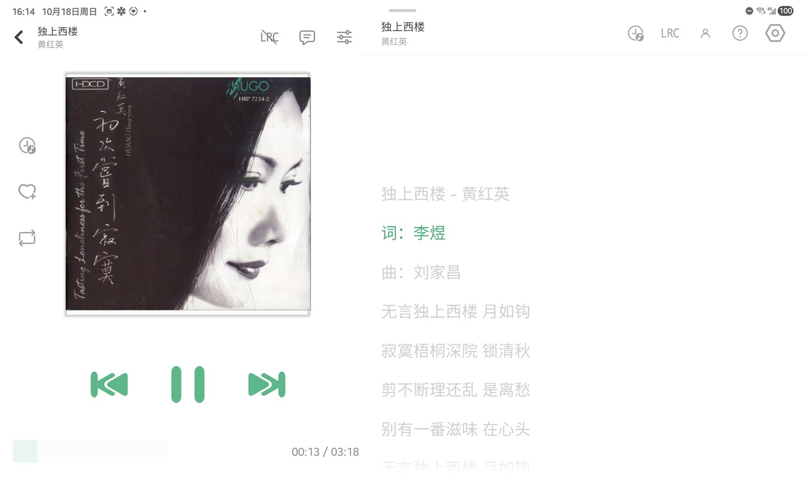 | 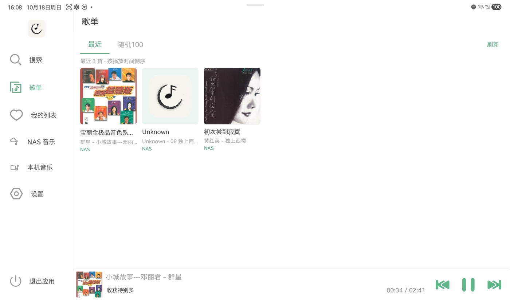 | 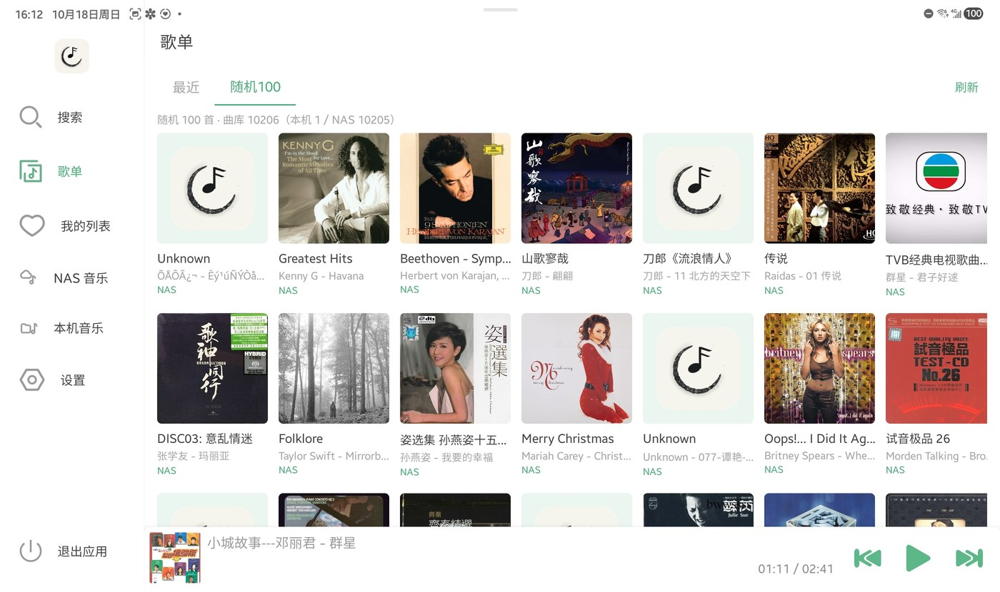 |

| NAS 音乐 | NAS 专辑浏览 | 搜索结果 |
|---|---|---|
| 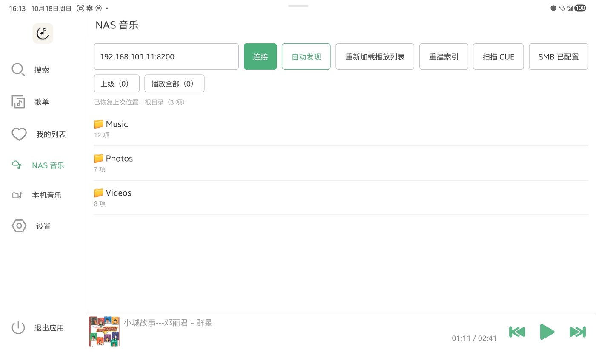 | 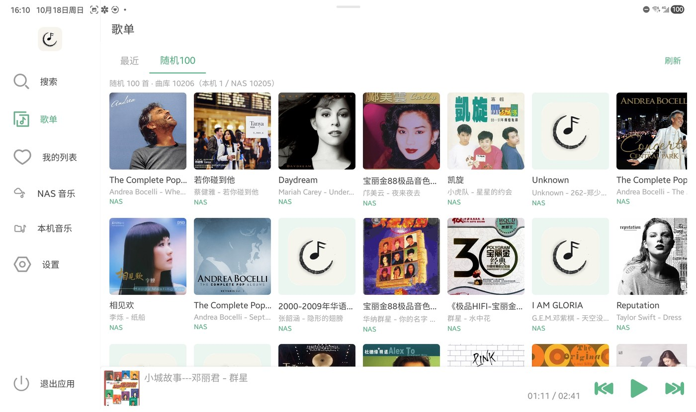 | 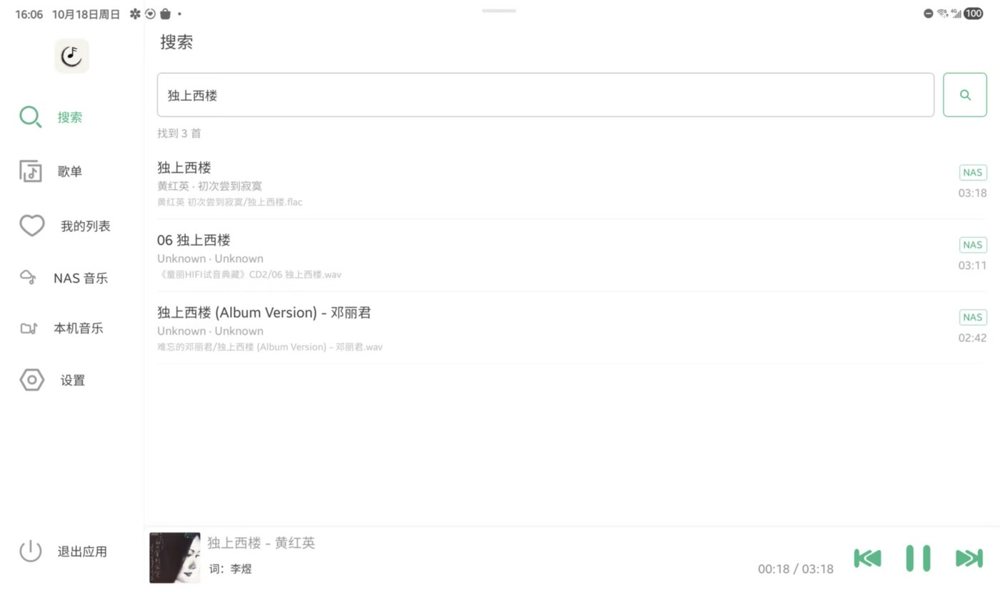 |

| 播放页操作菜单 | 歌曲信息 | 我的列表 |
|---|---|---|
| 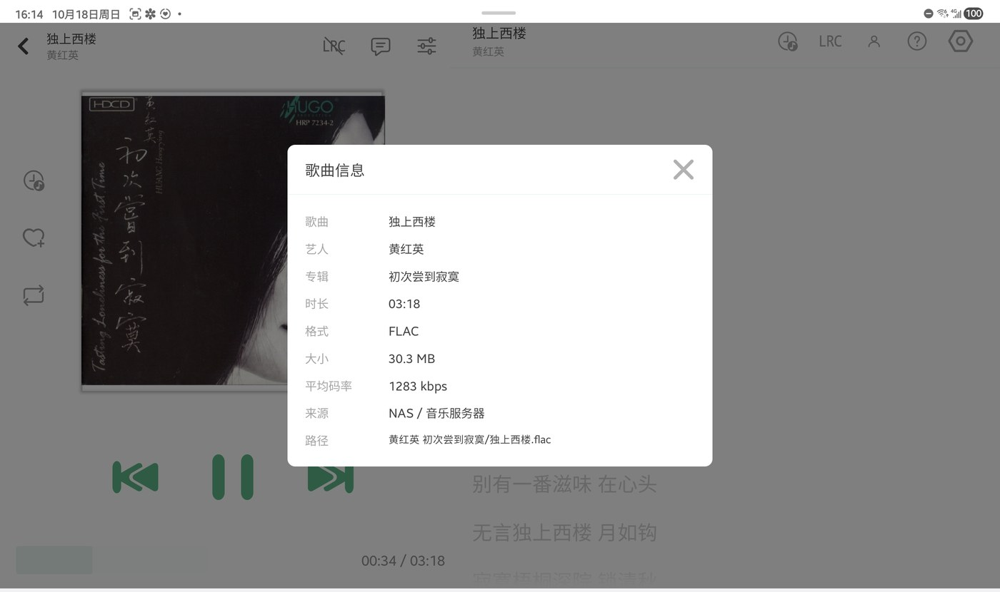 | 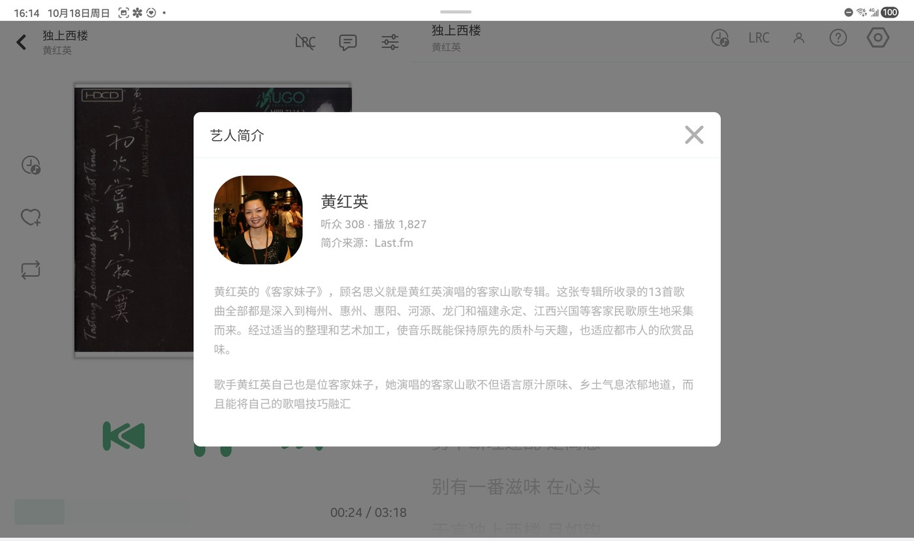 | 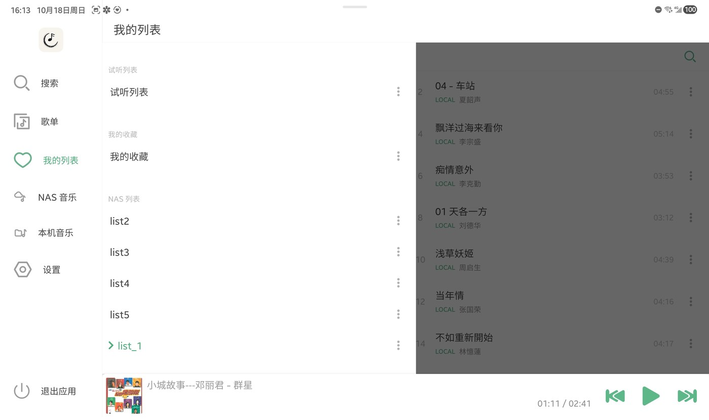 |

**手机（竖屏）**

| 歌单 | 设置（一级菜单） |
|---|---|
| 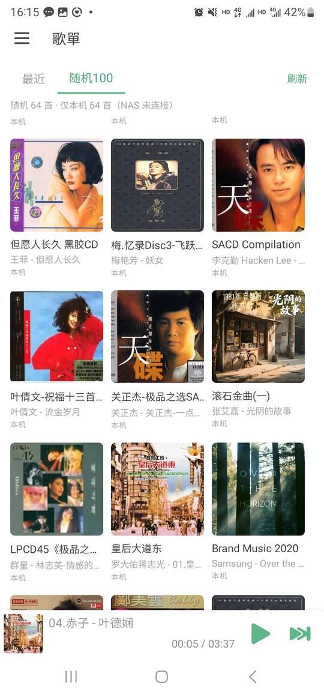 | 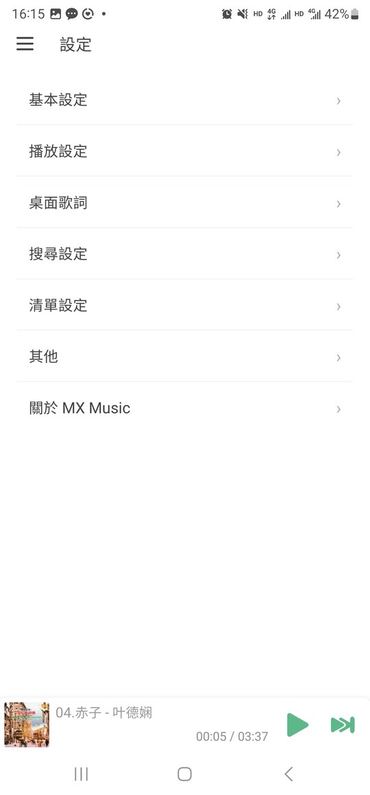 |

> 平板布局在屏幕宽度 ≥ 700dp 时生效（侧栏带文字、播放页左右分栏）。
> 歌单页封面缺失的条目会显示应用 logo —— 设计如此，不拿专辑图凑。

---

## 功能

### 双音源

- **NAS 音乐**：DLNA 浏览与播放，支持自动发现（SSDP）或手动填地址；一次性建立全库索引，之后不依赖逐层点目录
- **本机音乐**：Android MediaStore 扫描，带歌曲封面
- **统一歌单**：「最近」按播放时间倒序取近 100 首；「随机 100」从本机 + NAS 里随机抽，点标签即换一批
- **离线可用**：检测不到 NAS 时自动只用本机曲库，不会抽出点不开的歌

### 播放

- HTTP 流当本地文件播（NAS 资源无需先下载）
- CUE 整轨分轨：按 `.cue` 拆成多首，起播定位与自动切轨
- 远程内嵌封面解析（FLAC / MP3，Range 两段式）

### 歌词

- 多源歌词搜索
- **歌词同步微调 ±60 秒**，按歌曲单独记忆
- **桌面歌词**：系统悬浮窗，可与桌面其他内容共存

### 界面

- 平板适配：宽屏侧栏带文字、播放页左封面右歌词、竖屏封面不裁剪
- 歌单大图网格（手机 3 列 / 平板 4–8 列），卡片显示 专辑 / 艺人-歌名 / 来源
- 设置页一级菜单 → 二级页
- 自绘 SVG 导航图标

---

## 安全与隐私

- **无广告、无统计、无账号**：整包检索不到广告或埋点 SDK，也不需要注册登录
- **数据不外传**：不向任何自有服务器上传使用数据；歌单、播放记录、NAS 地址只存在本机
- **明文 HTTP 默认关闭**：只对确实仅提供 http 的音乐平台域名开口（酷我 / 酷狗 / 网易云 / 咪咕 / QQ / 百度），其余一律要求 https
- **权限精简**：11 个权限，全部对应播放功能；无定位、无相机 / 麦克风、无通讯录 / 短信、不读设备号
- **不请求安装未知应用**：应用内不下载安装 APK，升级靠手动装包

> 以上基于对 release APK 的静态审查（拆包 + 反编译 + 权限审计）逐条核对，不是宣传口径。

## 安装

| 项 | 要求 |
|---|---|
| 系统 | Android 8.0+（`minSdk 21`，实测 Android 13 / 三星 One UI） |
| 架构 | arm64-v8a（APK 按 ABI 拆分，装 `arm64-v8a` 那个） |
| 包名 | `cn.toside.music.mobile.mod`（可与官方 LX Music 共存） |
| 权限 | 读取音乐文件、网络、悬浮窗（桌面歌词）、忽略电池优化 |

安装后首次进入需要：

1. 授予「音乐和音频」读取权限 → 本机页点「扫描本机音乐」
2. NAS 页填地址（如 `192.168.1.10:8200`）或点「自动发现」

详细步骤见 [FAQ](FAQ.md)。

---

## 从源码构建

> 完整依赖与踩坑说明见 [`docs/构建与发布.md`](docs/构建与发布.md)。

```bash
# 1. 依赖
npm install

# 2. 构建（需 JDK 17 + Android SDK 36 + NDK 26.1）
cd android && ./gradlew assembleRelease

# 产物
# android/app/build/outputs/apk/release/mx-music-v1.0-arm64-v8a.apk
```

**签名**：仓库内不含任何签名文件。把 `android/keystore.properties.example` 复制为
`android/keystore.properties` 并填入自己的 keystore；不创建也能构建（自动退回 debug 签名，仅适合自己安装测试）。

开发文档：[`docs/架构.md`](docs/架构.md)。

---

## 已知限制

- **DSD（.dsf / .dff）不支持**：需要服务端转码或更换播放内核
- **DLNA 只读**：写回歌词/元数据需要 SMB 通道
- **NAS 目录层级**：界面显示的「路径」是索引里的直接父目录 + 文件名，不是完整层级（DLNA 不暴露真实路径）
- **首次进歌单可能等 1.5 秒**：在做 NAS 可达性探测
- **均衡器未实现**：方案已评估，见文档待办

---

## 与上游的关系

本项目是 [lyswhut/lx-music-mobile](https://github.com/lyswhut/lx-music-mobile) 的**个人修改版**（Apache-2.0）：

- 保留全部上游功能，改动集中在「音源接入、歌单、歌词、平板适配」
- 不修改、不替代上游，也不代表上游立场
- 修改点清单见 [`NOTICE`](NOTICE) 与 [`CHANGELOG.md`](CHANGELOG.md)
- 上游的变更记录与 FAQ 保留在 [`docs/upstream-CHANGELOG.md`](docs/upstream-CHANGELOG.md)、[`docs/upstream-FAQ.md`](docs/upstream-FAQ.md)

## 许可

[Apache License 2.0](LICENSE)。仅供个人学习与技术研究，请勿用于商业用途；
使用第三方音乐源产生的版权问题与作者无关。
